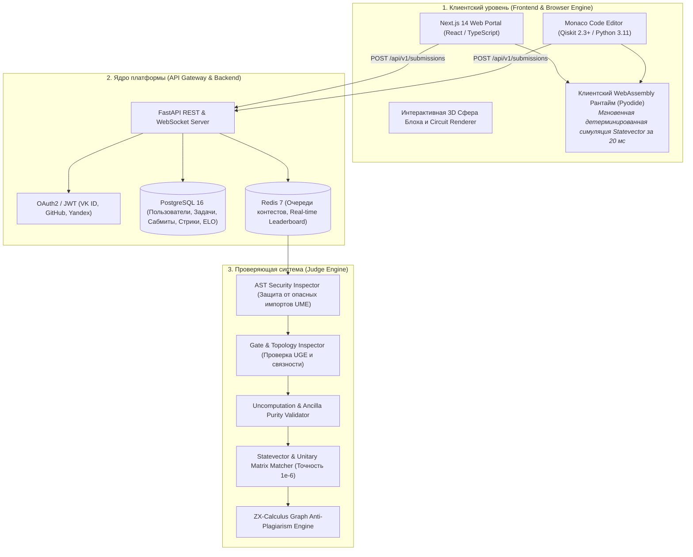
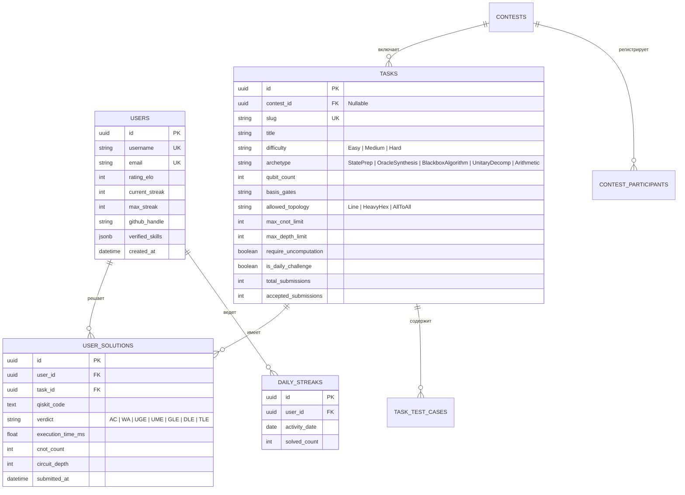

# Техническое задание (ТЗ) на разработку MVP платформы «QuantumArena»
## Специализация: Квантовые алгоритмы и синтез схем (Quantum Circuit & Algorithm Arena)

## 1. Общие сведения и назначение системы

* **Наименование системы:** Платформа квантового спортивного программирования и алгоритмический тренажер синтеза квантовых схем «QuantumArena» (по модели QCoder и Microsoft Quantum Katas).
* **Ключевой фокус продукта:** Решение строгих квантовых алгоритмических задач:
  1. **Синтез квантовых состояний (State Preparation):** $W$-состояния, Dicke states, GHZ, равномерные суперпозиции;
  2. **Синтез обратимых оракулов (Oracle Synthesis):** Построение квантовых схем для классических функций $f(x)$ с обязательной очисткой анцилл (**Uncomputation**);
  3. **Работа с закрытыми оракулами (Black-box Quantum Algorithms):** Алгоритмы Дойча-Йожи, Бернштейна-Вазирани, Гровера, Саймона, Phase Estimation;
  4. **Оптимизация схем (Circuit Synthesis & KAK):** Трансляция под топологические ограничения линейных/решеточных процессоров с минимизацией двухкубитных гейтов;
  5. **Квантовая арифметика:** Сумматоры, циклические сдвиги, модульная арифметика.

---

## 2. Архитектура и двухуровневый рантайм



---

## 3. Спецификация судейской системы (Judge Engine) и вердикты

```
┌────────────────────────────────────────────────────────────────────────────────────────┐
│                        ТАБЛИЦА ВЕРДИКТОВ СУДЕЙСКОЙ СИСТЕМЫ                             │
├────────────────────┬──────────────────────────────────┬────────────────────────────────┤
│ ВЕРДИКТ (СТАТУС)   │ РАСШИФРОВКА                      │ ПРИЧИНА ВОЗНИКНОВЕНИЯ          │
├────────────────────┼──────────────────────────────────┼────────────────────────────────┤
│ **AC (Accepted)**  │ Решение принято                  │ 100% совпадение Statevector /  │
│                    │                                  │ Unitary, анциллы очищены       │
├────────────────────┼──────────────────────────────────┼────────────────────────────────┤
│ **WA (Wrong Ans)** │ Неверный ответ                   │ Fidelity < 1.0 - 1e-6 или      │
│                    │                                  │ не очищены анциллы (Uncomp Fail│
├────────────────────┼──────────────────────────────────┼────────────────────────────────┤
│ **UGE**            │ Unauthorized Gate Error          │ Использован гейт не из базиса  │
│                    │                                  │ задачи (напр. Initialize/Unitary)│
├────────────────────┼──────────────────────────────────┼────────────────────────────────┤
│ **UME**            │ Unauthorized Module Error        │ Попытка импорта неразрешенного │
│                    │                                  │ модуля (os, sys, ctypes и т.д.)│
├────────────────────┼──────────────────────────────────┼────────────────────────────────┤
│ **GLE**            │ Gate Limit Exceeded              │ Превышен лимит на число 2Q гейтов│
├────────────────────┼──────────────────────────────────┼────────────────────────────────┤
│ **DLE**            │ Depth Limit Exceeded             │ Превышена критическая глубина  │
├────────────────────┼──────────────────────────────────┼────────────────────────────────┤
│ **TLE / MLE**      │ Time / Memory Limit Exceeded     │ Превышен лимит времени (2 сек) │
└────────────────────┴──────────────────────────────────┴────────────────────────────────┘
```

---

## 4. Схема базы данных (PostgreSQL 16)


