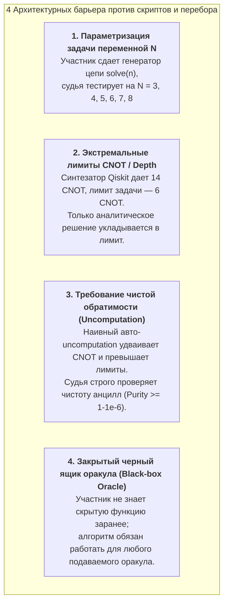
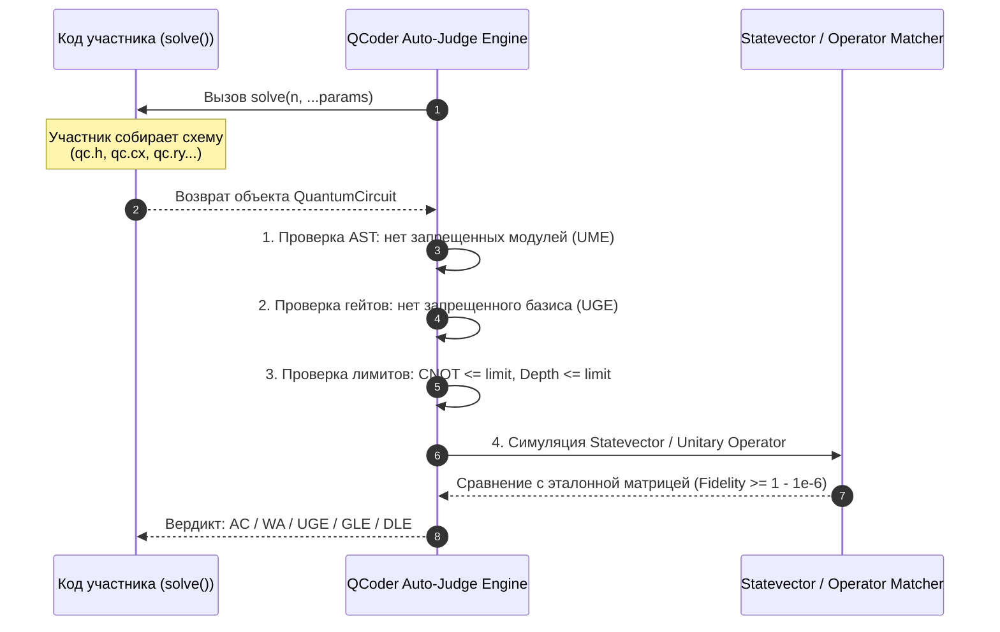

# Архитектура квантового LeetCode: Опыт QCoder.jp, реализация оракулов и защита от перебора

## 1. Развенчание мифа о «переборе»: Комбинаторная сложность синтеза квантовых схем

### Вопрос: «Не сможет ли участник написать простой скрипт, который за пару секунд переберет все комбинации вентилей на 3–6 кубитах?»

### Математический расчет мощности пространства перебора:

Пусть синтезируется схема на $N$ кубитах с дискретным базисом вентилей $G = \{H, X, Y, Z, S, T, \text{CNOT}, \text{CZ}, \text{SWAP}\}$ глубины $D$.

1. **Количество вариантов на каждом слое:**
   * Однокубитные гейты: $|G_{1Q}| \times N = 6 \times N$;
   * Двухкубитные гейты на произвольную пару $(i, j)$: $|G_{2Q}| \times \binom{N}{2} \times 2 = 3 \times N(N-1)$.
   * Суммарное число элементарных операций на шаг: $K(N) = 6N + 3N(N-1)$.
2. **Общее число возможных топологий цепи глубины $D$:**
   $$\Omega(N, D) \approx [K(N)]^D$$

```
┌────────────────────────────────────────────────────────────────────────────────────────┐
│               КОМБИНАТОРНЫЙ ВЗРЫВ ПРОСТРАНСТВА ПОИСКА КВАНТОВЫХ СХЕМ                    │
├───────────────┬──────────────────────┬───────────────────────┬─────────────────────────┤
│ ЧИСЛО КУБИТОВ │ ГЛУБИНА СХЕМЫ (D)    │ ВАРИАНТОВ НА ШАГ K(N) │ РАЗМЕР ПРОСТРАНСТВА (Ω) │
├───────────────┼──────────────────────┼───────────────────────┼─────────────────────────┤
│ **3 кубита**  │ $D = 5$              │ 36 вариантов          │ $36^5 \approx 6.0 \times 10^7$ (секунды) │
│ **3 кубита**  │ $D = 10$             │ 36 вариантов          │ $36^{10} \approx 3.6 \times 10^{15}$ (дни) │
│ **4 кубита**  │ $D = 10$             │ 60 вариантов          │ $60^{10} \approx 6.0 \times 10^{17}$ (годы) │
│ **5 кубитов** │ $D = 12$             │ 90 вариантов          │ $90^{12} \approx 2.8 \times 10^{23}$ (невозможно) │
└───────────────┴──────────────────────┴───────────────────────┴─────────────────────────┘
```

> [!IMPORTANT]
> **Вывод 1 (Дискретные гейты):** Уже при 4 кубитах и глубине 10 пространство перебора составляет $\approx 6 \times 10^{17}$ состояний. Полный перебор (Brute-force) на Python/C++ принципиально невозможен за время соревновательного раунда.
>
> **Вывод 2 (Параметрические гейты):** Если в схеме присутствуют непрерывные вращения $R_x(\theta), R_y(\theta), R_z(\theta), \theta \in [0, 2\pi)$, пространство состояний становится **континуальным**. Перебор углов требует невыпуклой оптимизации в пространстве $\mathbb{R}^k$, которая мгновенно застревает в локальных минимумах без аналитического вывода углов.

---

## 2. 4 Механизма 100% защиты задач от решателей и компиляторов

Даже если участник попытается применить специализированные квантовые синтезаторы (Qiskit Transpiler level 3, BQSKit, QSearch, PyZX), платформа защищается следующими архитектурными паттернами:



1. **Параметризация $N$ (Dynamic Dimension Testing):**
   Вместо фиксированной задачи «построй схему на 3 кубита», формулируется: *«Реализуйте функцию `generate_circuit(n: int) -> QuantumCircuit`, синтезирующую состояние $|W_n\rangle$ для произвольного $N \in [3, 10]$ за $\text{CNOT} \le 2(n-1)$»*. Скрипт перебора не может обобщить схему на произвольное $N$.
2. **Жесткий лимит на двухкубитные вентили (Strict Gate Bounds):**
   Автоматические компиляторы (типа `qiskit.transpile`) используют универсальную декомпозицию Шеннона или KAK, которые дают завышенное число CNOT. В олимпиадной задаче лимит ставится на теоретически минимальный уровень, достижимый только человеком.
3. **Контроль фазовой чистоты анцилл (Strict Uncomputation):**
   Судейский скрипт проверяет состояние регистра после применения схемы на всех $2^N$ базисных векторах. Если хотя бы на одном векторе вспомогательный кубит не вернулся в $|0\rangle$ (или изменил исходное состояние грязной анциллы), решение дисквалифицируется с вердиктом `WA (Uncomputation Failed)`. Стандартный автосинтез не укладывается в лимиты CNOT при добавлении зеркального разбора.

---

## 3. Как на самом деле устроены задачи и оракулы: Анализ архитектуры QCoder.jp

В соревновательном квантовом программировании участник **НЕ сдает сырой код симулятора и НЕ может подменить проверку**. 

### Формат сдачи решения:
Участник отправляет функцию, которая **конструирует и возвращает объект квантовой схемы (`QuantumCircuit`)**. Судья берет эту схему, изолирует её от внешнего мира и математически валидирует её унитарную матрицу или вектор состояния.



---

## 4. Два фундаментальных архетипа задач с оракулами

### АРХЕТИП А: «Построй оракул для заданной классической функции» (Oracle Synthesis)
* **В чём суть:** Дано математическое описание классической функции $f: \{0, 1\}^n \to \{0, 1\}$.
* **Что делает участник:** Строит обратимую квантовую схему $U_f |x\rangle |y\rangle = |x\rangle |y \oplus f(x)\rangle$ или фазовый оракул $U_f |x\rangle = (-1)^{f(x)} |x\rangle$ с использованием вспомогательных кубитов и их обязательной очисткой (Uncomputation).
* **Примеры реальных задач QCoder:**
  - *Cyclic Shift Oracle:* $|x\rangle \mapsto |(x + k) \bmod 2^n\rangle$;
  - *Less Than Oracle:* $|x\rangle |q\rangle \mapsto |x\rangle |q \oplus [x < K]\rangle$;
  - *Prime Number Phase Oracle:* $|x\rangle \mapsto (-1)^{[x \in \mathbb{P}]} |x\rangle$.

### АРХЕТИП Б: «Используй закрытый черный ящик оракула» (Black-box Algorithm Execution)
* **В чём суть:** Судья передает в функцию участника непрозрачный квантовый гейт `oracle_gate`, внутри которого зашит секретный параметр (например, скрытая маска $s$ в алгоритме Бернштейна-Вазирани или период $r$ в алгоритме Саймона).
* **Что делает участник:** Конструирует квантовый алгоритм вокруг переданного оракула, применяет интерференцию (гейты Адамара) и за **ровно 1 запуск схемы** восстанавливает скрытый параметр $s$.
* **Участник не может «разобрать» оракул:** Судейская система оборачивает оракул в непрозрачный непросматриваемый кастомный гейт, защищенный от интроспекции.

---

## 5. Детальные спецификации 3 реальных задач с оракулами и синтезом

Ниже приведены **3 строгие задачи**, демонстрирующие оба архетипа, устройство судейской проверки и защиту от классического обхода.

---

### ЗАДАЧА 1 (Архитип А): «Квантовый оракул проверки палиндрома (Bit Oracle with Uncomputation)»

#### 1. Формальное математическое условие:
Дан 4-кубитный входной регистр $|x_0 x_1 x_2 x_3\rangle$, кодирующий 4-битовую строку $x$. Требуется построить обратимый квантовый оракул $U_{\text{pal}}$, действующий на 4 входных кубитах, 1 целевом кубите $|y\rangle$ и не более чем 2 анциллах:
$$U_{\text{pal}} |x_0 x_1 x_2 x_3\rangle |y\rangle |00\rangle_{\text{anc}} = |x_0 x_1 x_2 x_3\rangle |y \oplus f_{\text{pal}}(x)\rangle |00\rangle_{\text{anc}}$$
где $f_{\text{pal}}(x) = 1 \iff (x_0 == x_3) \land (x_1 == x_2)$.

#### 2. Ограничения:
* Базис: $\{X, \text{CNOT}, \text{Toffoli (CCX)}\}$;
* Число анцилл: строго $\le 2$;
* Лимит двухкубитных/трехкубитных гейтов: $\le 10$;
* **Условие чистоты:** Анциллы обязаны вернуться в $|00\rangle$ для всех 16 входных состояний.

#### 3. Эталонное решение участника:
```python
from qiskit import QuantumCircuit

def build_palindrome_oracle() -> QuantumCircuit:
    # 4 кубита входа (0..3), 1 целевой кубит y (4), 2 анциллы (5, 6)
    qc = QuantumCircuit(7)
    
    # 1. Проверка x0 == x3 (эквивалентно x0 XOR x3 == 0)
    # Записываем x0 XOR x3 в анциллу 5
    qc.cx(0, 5)
    qc.cx(3, 5)
    qc.x(5) # Теперь анцилла 5 равна 1, если x0 == x3
    
    # 2. Проверка x1 == x2
    qc.cx(1, 6)
    qc.cx(2, 6)
    qc.x(6) # Теперь анцилла 6 равна 1, если x1 == x2
    
    # 3. Применение логического И на целевой кубит y (кубит 4)
    qc.ccx(5, 6, 4)
    
    # 4. ОБЯЗАТЕЛЬНЫЙ UNCOMPUTATION (зеркальная очистка анцилл)
    qc.x(6)
    qc.cx(2, 6)
    qc.cx(1, 6)
    
    qc.x(5)
    qc.cx(3, 5)
    qc.cx(0, 5)
    
    return qc
```

#### 4. Судейский скрипт проверки (Auto-Judge Validator):
```python
import numpy as np
from qiskit import QuantumCircuit
from qiskit.quantum_info import Statevector

def judge_palindrome_oracle(user_qc: QuantumCircuit) -> dict:
    if user_qc.num_qubits > 7:
        return {"verdict": "Wrong Answer", "reason": "Превышено максимальное число кубитов"}
        
    for x in range(16):
        b0 = (x >> 0) & 1
        b1 = (x >> 1) & 1
        b2 = (x >> 2) & 1
        b3 = (x >> 3) & 1
        is_pal = 1 if (b0 == b3 and b1 == b2) else 0
        
        for y in [0, 1]:
            test_qc = QuantumCircuit(7)
            if b0: test_qc.x(0)
            if b1: test_qc.x(1)
            if b2: test_qc.x(2)
            if b3: test_qc.x(3)
            if y:  test_qc.x(4)
            
            test_qc.compose(user_qc, inplace=True)
            sv = Statevector.from_instruction(test_qc)
            
            expected_y = y ^ is_pal
            # Индекс целевого базисного состояния
            # биты: anc1(6), anc0(5), y(4), x3(3), x2(2), x1(1), x0(0)
            expected_index = (0 << 6) | (0 << 5) | (expected_y << 4) | (b3 << 3) | (b2 << 2) | (b1 << 1) | b0
            
            prob = np.abs(sv.data[expected_index])**2
            if not np.isclose(prob, 1.0, atol=1e-5):
                return {
                    "verdict": "Wrong Answer (WA)",
                    "failed_on": f"x={b3}{b2}{b1}{b0}, y={y}",
                    "reason": "Неверное значение целевого кубита или не очищены анциллы (Uncomputation Failed)!"
                }
                
    return {"verdict": "Accepted (AC)", "tests_passed": 32}
```

---

### ЗАДАЧА 2 (Архитип Б): «Алгоритм Бернштейна-Вазирани против непрозрачного черного ящика»

#### 1. Формальное математическое условие:
Судья предоставляет функцию `oracle_gate`, реализующую фазовый оракул для неизвестной битовой строки $s \in \{0, 1\}^n$:
$$U_s |x\rangle = (-1)^{s \cdot x} |x\rangle, \quad s \cdot x = \bigoplus_{i=0}^{n-1} s_i x_i$$
Требуется написать функцию `find_secret_string(n: int, oracle_gate: Gate) -> str`, которая с помощью квантового алгоритма определяет секретную строку $s$ **ровно за 1 вызов оракула**.

#### 2. Эталонное решение участника:
```python
from qiskit import QuantumCircuit
from qiskit.circuit import Gate

def find_secret_string(n: int, oracle_gate: Gate) -> str:
    qc = QuantumCircuit(n, n)
    # 1. Создаем суперпозицию
    qc.h(range(n))
    # 2. Применяем черный ящик оракула
    qc.append(oracle_gate, range(n))
    # 3. Интерференция
    qc.h(range(n))
    # 4. Измерение
    qc.measure(range(n), range(n))
    
    # Симуляция единичного шота (Shot = 1)
    from qiskit.primitives import Sampler
    result = Sampler().run(qc, shots=1).result()
    measured_int = list(result.quasi_dists[0].keys())[0]
    
    # Форматирование в двоичную строку длины n
    secret = format(measured_int, f'0{n}b')[::-1] # Little endian
    return secret
```

#### 3. Судейский скрипт проверки (Генерация 50 скрытых тестов):
```python
import random
from qiskit import QuantumCircuit

def create_secret_bv_oracle(s_str: str) -> QuantumCircuit:
    n = len(s_str)
    qc = QuantumCircuit(n, name="SecretOracle")
    for i, bit in enumerate(s_str):
        if bit == '1':
            qc.z(i)
    return qc.to_gate()

def judge_bernstein_vazirani(user_func) -> dict:
    for test_idx in range(50):
        n = random.randint(3, 8)
        secret_s = "".join(random.choice(['0', '1']) for _ in range(n))
        oracle_gate = create_secret_bv_oracle(secret_s)
        
        user_answer = user_func(n, oracle_gate)
        if user_answer != secret_s:
            return {
                "verdict": "Wrong Answer (WA)",
                "failed_test": test_idx,
                "expected": secret_s,
                "got": user_answer
            }
            
    return {"verdict": "Accepted (AC)", "passed_tests": 50}
```

---

### ЗАДАЧА 3: «Квантовый циклический сдвиг регистра (Quantum Cyclic Shift)»

#### 1. Формальное математическое условие:
Построить квантовую схему, осуществляющую циклический сдвиг амплитуд $n$-кубитного квантового регистра на $+1$:
$$U_{\text{shift}} |x\rangle = |(x + 1) \bmod 2^n\rangle, \quad \forall x \in \{0, 1, \dots, 2^n - 1\}$$
для произвольного $n \in [2, 6]$.

#### 2. Ограничения:
* Анциллы: **0 (in-place операция)**;
* Разрешенные гейты: $\{X, \text{MCX} \text{ (Multi-Controlled X)}\}$;
* Лимит на гейты: ровно $n$ вентилей типа $C^k X$.

#### 3. Эталонное решение участника:
```python
from qiskit import QuantumCircuit

def build_cyclic_shift(n: int) -> QuantumCircuit:
    qc = QuantumCircuit(n)
    # Инкремент двоичного числа: q0 инвертируется всегда,
    # q1 инвертируется если q0==1,
    # q2 инвертируется если q0==1 и q1==1, и т.д.
    # Чтобы не портить условия, применяем вентили от старших к младшим:
    for i in range(n - 1, 0, -1):
        control_qubits = list(range(i))
        qc.mcx(control_qubits, i)
    qc.x(0)
    return qc
```

---

## 6. Итоговый вывод: Почему платформа реализуема и защищена

1. **Невозможность перебора:** Размер пространства дискретных схем на 4 кубитах ($\Omega \ge 10^{17}$) исключает поиск перебором за отведенные 2 секунды процессорного времени.
2. **Строгость проверки оракулов:** Судья проверяет не промежуточные вычисления в Python, а **результирующий унитарный оператор схемы и вектор состояния** с помощью точной линейной алгебры.
3. **Решаемость за 45–90 минут:** Участник решает красивую дискретную алгоритмическую задачу на обратимую логику и пишет компактный, элегантный код на Qiskit.
