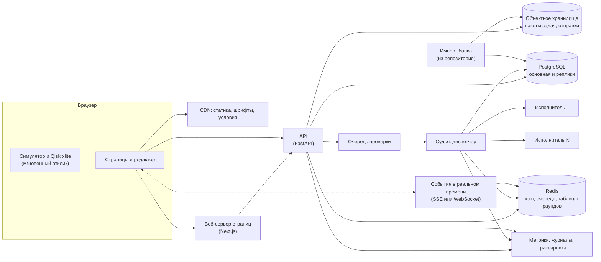

# 3. Архитектура, нагрузка, надёжность

[← к оглавлению](README.md)

## 3.1. Схема

Четыре независимых части, у каждой — свой способ масштабирования:

| Часть | Что делает | Масштабирование |
|---|---|---|
| Веб и CDN | отдаёт страницы и статику | горизонтально; условия и статика кэшируются |
| API | аккаунты, банк, отправки, раунды, рейтинг | горизонтально, без состояния в памяти |
| Судья | проверяет отправки | число исполнителей растёт по длине очереди |
| Данные | PostgreSQL, Redis, объектное хранилище | вертикально и репликами на чтение |

Судья отделён от API очередью: если он перегружен или упал, сайт работает, отправки принимаются и ждут.

## 3.2. Стек

Стек наследует первую версию спецификации ([`docs/specs/01_platform_technical_spec.md`](../specs/01_platform_technical_spec.md))
с уточнениями. **[Д]** Выбор можно пересмотреть, если у команды другой опыт; требования раздела от стека не
зависят.

| Слой | Рекомендуется | Почему | Допустимая замена |
|---|---|---|---|
| Страницы | Next.js, React, TypeScript | серверная сборка страниц и приложение-редактор в одном проекте | Nuxt, SvelteKit |
| Редактор кода | CodeMirror 6 | лёгкий, работает на телефоне | Monaco |
| Доска схем | свой компонент на SVG — перенос `board.js` | уже сделан под дизайн | — |
| Формулы | KaTeX, отрисовка на сервере | скорость, нет внешних запросов | MathJax |
| API | Python 3.12, FastAPI, SQLAlchemy 2, Alembic | судья и банк написаны на Python, общий код моделей | — |
| База | PostgreSQL 16 | транзакции, JSONB для фасетов, репликация | — |
| Кэш, таблицы раундов, блокировки | Redis 7 | упорядоченные множества для таблиц, издатель-подписчик для событий | Valkey |
| Очередь проверки | Redis Streams на первом этапе | одна зависимость вместо двух; подтверждение и повторная доставка есть | RabbitMQ, NATS JetStream при росте |
| Объектное хранилище | совместимое с S3 | пакеты задач, тексты отправок, резервные копии | — |
| Исполнители | контейнеры с усиленной изоляцией (gVisor или микровиртуальные машины Firecracker) | исполняется чужой код | nsjail на выделенных машинах |
| Развёртывание | Kubernetes в управляемом облаке | автомасштабирование исполнителей | Docker Compose на этапе закрытой беты |
| Наблюдаемость | Prometheus, Grafana, Loki, OpenTelemetry | открытые, разворачиваются в РФ | — |
| Облако | российский провайдер с управляемыми PostgreSQL и Kubernetes | хранение персональных данных в РФ; в опросе участники отмечали недоступность зарубежных сервисов | — |

Код, который должен исполняться и в браузере, и на сервере одинаково (модель схемы, подсчёт глубины и числа
гейтов), существует в двух реализациях: TypeScript в браузере и Python в судье. Их согласованность проверяется
общим набором тестовых схем в CI (раздел 7.6).

## 3.3. Расчёт нагрузки

**[Д]** Цифры — допущение, которое нужно подтвердить. Опора: в хакатоне «Хакни квант» участвовали 379 и 314
человек по двум трекам; в шести контестах QCoder — 551 уникальный участник. Платформа рассчитывается с запасом
на порядок.

| Ступень | Зарегистрировано | В одном раунде | Когда |
|---|--:|--:|---|
| Закрытая бета | 500 | 100 | конец этапа 3 |
| Запуск | 5 000 | 1 000 | первые месяцы |
| Расчётная | 50 000 | 5 000 | первый год; на неё проектируются схема данных и очередь |
| Предельная | 500 000 | 20 000 | архитектура не должна её исключать; оборудование под неё не закупается |

### Отправки

Раунд: $P$ участников, $T$ задач, в среднем $a$ отправок на задачу, длительность $D$ секунд. Средний поток
отправок

$$\lambda_{\text{ср}}=\frac{P\,T\,a}{D}.$$

Для расчётной ступени: $P=5000$, $T=4$, $a=3$, $D=5400$ даёт $\lambda_{\text{ср}}\approx 11$ отправок в секунду.
В последние минуты поток вырастает в несколько раз; принимаем коэффициент пика $k=5$:
$\lambda_{\text{пик}}\approx 55$ отправок в секунду.

### Исполнители

Если проверка одной отправки занимает в среднем $\bar{t}$ секунд процессорного времени, то очередь не растёт
при числе ядер

$$W\ \ge\ \lambda\,\bar{t}.$$

Замер на заглушке ([`bank/tools/verify.py`](../../bank/tools/verify.py), одно ядро): полная проверка одной
задачи ядра — эталон и все неверные решения по всем наборам параметров — занимает от 0,003 до 0,7 секунды,
медиана 0,01 секунды; исключение — SA-038 с многократными запусками схемы, около 6 секунд. Весь банк (61 эталон
и 74 неверных решения) проходит за 9 секунд, импорт Qiskit — ещё 0,5 секунды. Боевая проверка дороже: закрытых
тестов больше, размеры крупнее, добавляется изоляция. Поэтому в расчёт закладываем с запасом $\bar{t}=1{,}5$ с
на отправку. Тогда в среднем нужно $W\approx 17$ ядер, на пике — $W\approx 83$.

Держать 83 ядра постоянно не нужно. Требование формулируется через время ожидания:

- вне пика: вердикт за 5 секунд у 95 % отправок;
- на пике раунда: за 30 секунд у 95 % отправок, за 120 секунд у всех;
- число исполнителей увеличивается автоматически по длине очереди и заранее — по расписанию, за 15 минут до
  конца раунда.

Импорт Qiskit занимает секунды, поэтому исполнитель держит прогретый процесс и создаёт для каждой отправки
изолированную копию, а не запускает интерпретатор с нуля (раздел 6.5).

### Чтение

| Событие | Оценка для расчётной ступени | Чем закрывается |
|---|---|---|
| Старт раунда: все открывают задачи в одну минуту | 5 000 участников, по 5–8 запросов: до 700 запросов в секунду | условия задач раунда готовятся заранее и отдаются из кэша; страница раунда не зависит от базы на чтение |
| Таблица результатов | 5 000 открытых таблиц | таблица считается один раз в Redis и рассылается изменениями, а не опросом (раздел 5.6) |
| Статус отправки | до 55 новых отправок в секунду, у каждой 3–4 смены состояния | события по подписке; запасной вариант — опрос не чаще раза в 2 секунды |
| Банк, рейтинг, профили | фоновая нагрузка | постраничные запросы по индексам, кэш на 30–60 секунд |

### База

Объём за первый год на расчётной ступени: 50 раундов по 60 000 отправок и столько же вне раундов — порядка
6 миллионов отправок. Текст отправки (в среднем 1–2 КБ) хранится в объектном хранилище, в базе — метаданные,
порядка 300 байт на строку: около 2 ГБ с индексами. Это небольшой объём; секционирование таблицы отправок по
времени закладывается в схему сразу, но включается при необходимости.

Соединения с базой идут через пул (PgBouncer). Запросы на чтение, не требующие свежести до секунды (банк,
рейтинг, профили), направляются на реплику.

## 3.4. Требования к надёжности

| Показатель | Значение |
|---|---|
| Доступность сайта | 99,5 % в месяц; во время раунда — без плановых работ |
| Потеря отправок | ноль: принятая отправка обязана получить вердикт |
| Допустимая потеря данных при аварии | до 5 минут (непрерывное архивирование журнала базы) |
| Время восстановления | до 1 часа; восстановление из резервной копии проверяется раз в квартал |
| Время ответа API | 95 % запросов — до 300 мс, 99 % — до 1 с |
| Отказ судьи | сайт работает, отправки копятся в очереди, участник видит «проверка задерживается» |
| Отказ Redis | вход и чтение банка работают; таблица раунда восстанавливается из базы |
| Отказ исполнителя посреди проверки | отправка возвращается в очередь и проверяется заново; участник этого не замечает |

Правило раунда: если проверка недоступна дольше 10 минут, жюри может продлить раунд или объявить его
нерейтинговым — эта возможность должна быть в административном контуре (раздел 9).

## 3.5. Нагрузочные испытания

Проводятся до закрытой беты и до каждого повышения ступени. Сценарии (инструмент — k6 или Locust):

1. **Старт раунда.** $P$ виртуальных участников за 60 секунд открывают страницу раунда и все задачи.
2. **Раунд.** 90 минут сжимаются до 15: поток отправок по профилю с пиком в конце, открытые таблицы, подписки
   на статусы.
3. **Отказ.** Во время сценария 2 останавливается половина исполнителей, затем один узел API, затем Redis.
4. **Перепроверка.** Перепроверка 20 000 отправок одновременно с обычной работой сайта.

Испытание пройдено, если выполнены показатели 3.3 и 3.4 и ни одна отправка не потеряна и не проверена дважды с
разным итогом.

## 3.6. Окружения и поставка

| Окружение | Назначение |
|---|---|
| Локальное | весь стек в Docker Compose одной командой; судья-заглушка; тестовые данные |
| Проверочное | копия боевого в малом размере; сюда попадает каждая принятая правка; нагрузочные испытания |
| Боевое | раздельные узлы для API, судьи и данных |

- Репозиторий один, с разделами: веб, API, судья, пакеты общего кода, банк, инфраструктура.
- Каждая правка проходит проверки: стиль, типы, тесты, сборка, снимки витрины компонентов, `bank/tools/verify.py`
  для изменённых задач.
- Инфраструктура описана кодом. Миграции базы обратимы и применяются без остановки сайта.
- Выкладка без простоя; откат — одной командой. В день раунда выкладки запрещены, кроме исправления аварий.
- Демо на GitHub Pages остаётся как архивная версия и не зависит от платформы.
