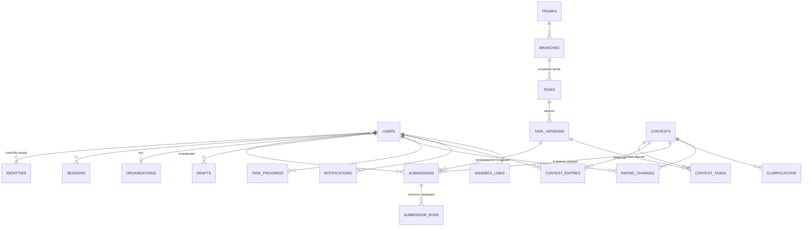
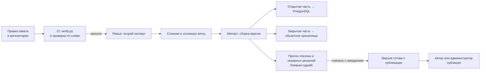

# 4. Данные: база, банк задач, импорт

[← к оглавлению](README.md)

## 4.1. Принципы

1. **Источник правды о задачах — репозиторий.** Пакеты лежат в [`bank/core`](../../bank/core), проходят
   `verify.py`, рецензируются как код. База хранит импортированные версии.
2. **Версии задач неизменяемы.** Исправление условия или тестов — новая версия. Отправка навсегда привязана
   к версии, по которой проверялась.
3. **Открытая и закрытая части пакета хранятся раздельно.** Участнику отдаётся только открытая: условие,
   ограничения, шаблон кода, открытые примеры. Эталон, спецификация, закрытые тесты, неверные решения и
   служебные поля доступны только судье и авторам.
4. **Отправки не теряются.** Отправка записывается в базу до постановки в очередь, одной
   транзакцией с записью о постановке (раздел 5.3).
5. **Производные данные пересчитываемы.** Таблица раунда, доля решивших, рейтинг вузов восстанавливаются из
   отправок и результатов раундов.

## 4.2. Схема

## 4.3. Таблицы

Типы даны для PostgreSQL. У каждой таблицы есть `created_at`, у изменяемых — `updated_at`. Идентификаторы —
`bigint` из последовательности, кроме оговорённых случаев; наружу в адресах отдаются логины, номера задач и
раундов, а не внутренние идентификаторы.

### Пользователи

| Таблица | Основные поля | Замечания |
|---|---|---|
| `users` | `id`, `login` (уникален без учёта регистра), `display_name`, `email` (уникален), `email_verified_at`, `password_hash` (может быть пустым при входе через внешнего провайдера), `organization_id`, `avatar_key`, `rating`, `rated_contests`, `role`, `locale`, `settings` JSONB, `banned_until`, `deleted_at` | `rating` — текущее значение для сортировки; история — в `rating_changes`. Удаление — обезличивание строки, а не стирание |
| `identities` | `user_id`, `provider` (`yandex`, `vk`), `subject`, уникальная пара (`provider`, `subject`) | привязанные внешние входы |
| `sessions` | `id` (случайный 256-битный), `user_id`, `expires_at`, `ip`, `user_agent`, `revoked_at` | сессия хранится на сервере; в браузере — только идентификатор в защищённой куке |
| `organizations` | `id`, `kind` (`university`, …), `name`, `short_name`, `city`, `verified` | справочник вузов; рейтинг вуза считается, не хранится |
| `audit_log` | `actor_id`, `action`, `object_type`, `object_id`, `details` JSONB, `ip` | все действия ролей выше участника и все изменения прав |

### Банк задач

| Таблица | Основные поля | Замечания |
|---|---|---|
| `trunks`, `branches` | `code` (`T1`, `T1.6`), `title`, `about`, `idea`, `position` | импортируются из [`bank/tree.yaml`](../../bank/tree.yaml) |
| `tasks` | `id`, `code` (`SA-005`, уникален), `slug`, `branch_id`, `status` (`draft`, `reference`, `reviewed`, `published`, `archived`), `current_version_id`, `visible_from`, `solved_count`, `attempted_count` | постоянная сущность задачи; `code` не меняется никогда |
| `task_versions` | `id`, `task_id`, `number`, `title`, `level`, `facets` JSONB, `limits` JSONB, `qubits` JSONB, `scoring` JSONB, `budget` JSONB, `signature`, `starter`, `gui`, `io` JSONB, `statement_md`, `statement_html`, `hints` JSONB, `editorial_md`, `examples` JSONB, `hybrid_branches`, `package_key`, `package_sha256`, `judge_profile`, `imported_from_commit`, `created_by` | неизменяема после создания. `statement_html` — готовая разметка с отрисованными формулами. `package_key` — закрытая часть в объектном хранилище |
| `task_internal` | `task_version_id`, `method` JSONB, `source` JSONB, `pitfalls` JSONB | отдельная таблица, чтобы служебные поля нельзя было случайно отдать участнику запросом «все поля версии» |
| `task_aliases` | `alias`, `task_id` | прежние номера (`SA-101`) и перенаправления |
| `task_progress` | `user_id`, `task_id`, `state` (`opened`, `attempted`, `solved`), `first_solved_at`, `best_submission_id`, `attempts` | одна строка на пару; обновляется при вердикте |

Соответствие полей карточки `task.yaml` и базы — один к одному; список полей и их смысл — в
[`bank/CLASSIFICATION.md`](../../bank/CLASSIFICATION.md), формальная схема — в
[`bank/schema/task.schema.json`](../../bank/schema/task.schema.json).

Для фильтров банка из `facets` выносятся вычисляемые столбцы с индексами: `level`, `answer_kind`, `input_kind`,
`check_kind`, `gui`, `branch_id`. Фильтр по смежным ветвям — индекс GIN по `hybrid_branches`.

### Отправки

| Таблица | Основные поля | Замечания |
|---|---|---|
| `submissions` | `id`, `public_id` (случайный, для адресов), `user_id`, `task_version_id`, `contest_id` (пусто вне раунда), `kind` (`code`, `circuit`, `value`), `source_key`, `source_sha256`, `client_token`, `status`, `verdict`, `verdict_detail` JSONB, `score`, `metrics` JSONB, `submitted_at`, `judged_at`, `judge_version`, `rejudge_of` | текст отправки — в объектном хранилище; `client_token` — ключ идемпотентности; уникальна пара (`user_id`, `client_token`) |
| `submission_runs` | `submission_id`, `attempt`, `started_at`, `finished_at`, `worker`, `status`, `groups` JSONB, `cpu_ms`, `memory_kb`, `log_key` | каждый прогон проверки, включая повторные после сбоя исполнителя и перепроверки |
| `drafts` | `user_id`, `task_id`, `kind`, `content`, `updated_at`, уникальна тройка | черновики схемы и кода; не версия и не отправка |

Индексы `submissions`: (`user_id`, `task_version_id`, `submitted_at`), (`contest_id`, `submitted_at`),
(`status`) частичный — только незавершённые. Таблица секционируется по `submitted_at` при росте (раздел 3.3).

`metrics` — ресурсы принятой схемы: число кубитов, гейтов, двухкубитных гейтов, глубина, вызовы оракула — те
же ключи, что в `limits` карточки. По ним строится сравнение с эталоном и баллы задач с оценкой.

### Раунды и рейтинг

| Таблица | Основные поля | Замечания |
|---|---|---|
| `contests` | `id`, `number`, `title`, `kind` (`rated`, `unrated`, `training`, `exam`), `starts_at`, `duration_s`, `freeze_s`, `rules` JSONB, `state`, `visible`, `rated_at` | `rules` — штраф за неверную отправку, баллы задач, шум, правила открытия отправок |
| `contest_tasks` | `contest_id`, `letter`, `task_version_id`, `points`, `position` | версия задачи закреплена на время раунда |
| `contest_entries` | `contest_id`, `user_id`, `mode` (`live`, `virtual`), `registered_at`, `started_at`, `score`, `penalty_s`, `place`, `rating_before`, `rating_after` | итоговые поля заполняются при подведении итогов; во время раунда таблица живёт в Redis |
| `clarifications` | `contest_id`, `task_letter`, `author_id`, `question`, `answer`, `public`, `answered_by` | вопросы жюри и объявления |
| `rating_changes` | `user_id`, `contest_id`, `old`, `new`, `place`, `performance` | неизменяемая история; `users.rating` — её последняя строка |

### Прочее

| Таблица | Основные поля | Замечания |
|---|---|---|
| `notifications` | `user_id`, `kind`, `payload` JSONB, `read_at` | колокольчик; почтовые письма — отдельная очередь |
| `sandbox_links` | `code` (короткий), `user_id` (может быть пустым), `circuit` JSONB, `views` | короткие ссылки песочницы |
| `activity_days` | `user_id`, `day`, `solved`, `submitted` | календарь активности и серия дней |
| `groups`, `group_members` | — | закладка под экзаменационный режим; в первой версии не используются |

## 4.4. Что где хранится

| Данные | Хранилище | Почему |
|---|---|---|
| Аккаунты, задачи, отправки (метаданные), раунды, рейтинг | PostgreSQL | транзакции и связи |
| Текст отправок, пакеты задач, журналы проверок, аватары, резервные копии | объектное хранилище | объём; база остаётся маленькой |
| Таблица идущего раунда, счётчики, сессии-кэш, ограничители частоты | Redis | скорость; всё восстанавливается из PostgreSQL |
| Очередь проверки | Redis Streams | раздел 5.3 |
| Условия задач в готовом виде | CDN и кэш API | условия версии неизменяемы — кэшируются без срока |
| Черновик гостя, тема, раскладка редактора | `localStorage` браузера | до регистрации; при регистрации черновики переносятся на сервер, как в демо ([`store.js`](../../assets/js/store.js)) |

## 4.5. Импорт банка

Требования к импорту:

1. Импорт идемпотентен: повторный запуск на том же коммите ничего не меняет. Версия определяется хэшем
   содержимого пакета.
2. Новая версия создаётся, только если изменился пакет. Изменение, не влияющее на проверку (опечатка в
   условии), помечается как «без перепроверки»; изменение `check.py`, `reference.py`, лимитов — как «требует
   решения о перепроверке».
3. Перед публикацией версия проходит **боевым** судьёй: эталон обязан получить «принято», каждое решение из
   `WRONG` — отказ. Это та же проверка, что делает `verify.py`, но в настоящем исполнителе.
4. Открытые примеры (`examples`) формируются из пакета явно; ничто из закрытой части не попадает в открытую
   автоматически.
5. Закрытые тесты. В заглушке `check.py` задаёт сетку параметров `GRID` и генераторы случаев с фиксированным
   зерном. Для боевой версии автор добавляет закрытую сетку, которой нет в открытом репозитории (отдельный
   закрытый репозиторий или шифрованный раздел) — иначе тесты публичны, как в демо. **[Д]** Где держать
   закрытую часть — решение команды; платформа должна поддерживать оба варианта.
6. Резерв ([`bank/reserve/reserve.yaml`](../../bank/reserve/reserve.yaml)) импортируется только в
   административный контур — как список идей со статусом и ответственным.
7. Дерево ([`bank/tree.yaml`](../../bank/tree.yaml)) импортируется тем же конвейером; удаление ветви, на которой
   есть задачи, запрещено.

Задачи демо (43 штуки, [`assets/js/data/tasks/`](../../assets/js/data/tasks)) в базу напрямую не переносятся:
их эталоны написаны на Qiskit-lite, а тесты — на конструкторах браузерного судьи. Для каждой нужной задачи
оформляется пакет; раскладка «задача демо → задача банка» — в [`bank/LEGACY.md`](../../bank/LEGACY.md).

## 4.6. Сохранность

- Непрерывное архивирование журнала PostgreSQL и ежесуточный полный снимок; хранение 30 дней.
- Объектное хранилище с версионированием для пакетов задач.
- Проверка восстановления раз в квартал на проверочном окружении.
- Персональные данные (почта, имя, вуз, адреса входа) — только в базе в РФ; в журналы и метрики не попадают.
