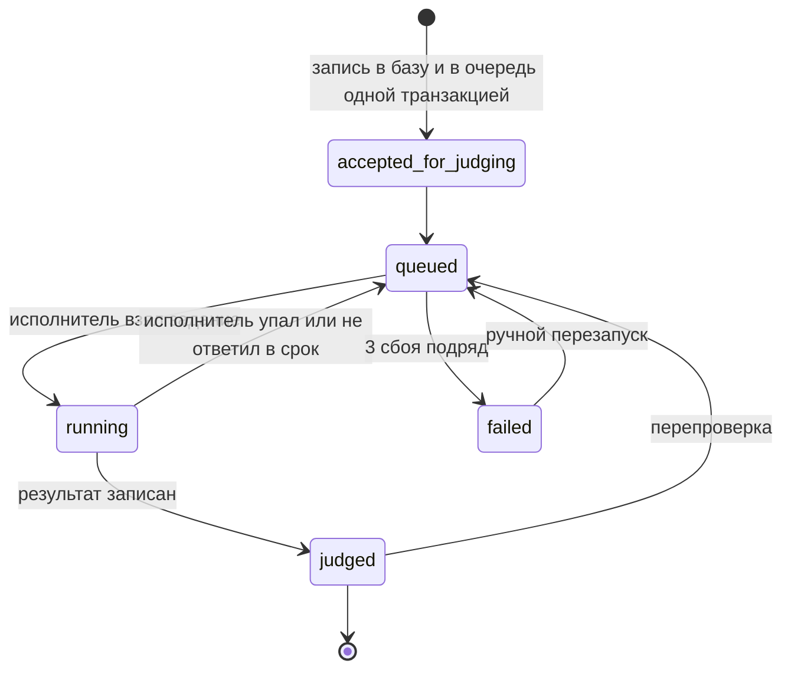

# 5. API, отправки, очередь, вердикты

[← к оглавлению](README.md)

## 5.1. Соглашения API

- HTTP и JSON, префикс `/api/v1`. Описание в формате OpenAPI генерируется из кода и публикуется на проверочном
  окружении; клиент на TypeScript генерируется из него же.
- Вход — сессионная кука с признаками `HttpOnly`, `Secure`, `SameSite=Lax`. Изменяющие запросы защищены от
  подделки межсайтовых запросов.
- Ошибки — единый вид: `{"error": {"code": "limit_exceeded", "message": "…", "details": {…}}}`. Код — для
  программы, сообщение — для человека, на языке интерфейса.
- Списки — постраничные по курсору: `?cursor=…&limit=50`. Ответ содержит `next_cursor`.
- Время — ISO 8601 в UTC. В каждом ответе о раунде есть серверное время `server_time`.
- Ограничение частоты — по пользователю и по адресу; при превышении ответ 429 с заголовком `Retry-After`.
- Изменение формата ответа, ломающее клиент, — только в новой версии префикса.

## 5.2. Ресурсы

| Метод и адрес | Назначение | Доступ |
|---|---|---|
| `POST /auth/register`, `/auth/login`, `/auth/logout`, `/auth/recover`, `/auth/verify-email` | аккаунт по почте | гость |
| `GET /auth/oauth/{provider}/start`, `/callback` | вход через Яндекс ID и VK ID | гость |
| `GET /me`, `PATCH /me`, `DELETE /me`, `GET /me/export` | профиль, настройки, удаление, выгрузка данных | участник |
| `GET /tree` | стволы и ветви с числом задач и прогрессом участника | все |
| `GET /tasks` | список банка с фильтрами `level`, `trunk`, `branch`, `answer`, `gui`, `state`, `q`, сортировкой | все |
| `GET /tasks/{code}` | открытая часть текущей версии: условие, ограничения, шаблон, примеры | все |
| `GET /tasks/{code}/editorial` | разбор | после решения или по правилам раунда |
| `GET /tasks/{code}/hints/{n}` | подсказка номер $n$; открытие записывается | участник |
| `GET`, `PUT /tasks/{code}/draft` | черновик | участник |
| `POST /tasks/{code}/submissions` | отправить решение | участник |
| `GET /tasks/{code}/submissions` | мои отправки по задаче | участник |
| `GET /submissions/{public_id}` | одна отправка | автор отправки, жюри |
| `GET /submissions/{public_id}/events` | поток событий статуса | автор отправки |
| `GET /contests`, `GET /contests/{n}` | расписание, раунд | все |
| `POST`, `DELETE /contests/{n}/registration` | запись и отмена | участник |
| `POST /contests/{n}/virtual` | начать участие «с таймером» | участник |
| `GET /contests/{n}/tasks`, `/tasks/{letter}` | задачи раунда | по состоянию раунда |
| `POST /contests/{n}/tasks/{letter}/submissions` | отправка в раунде | записавшийся |
| `GET /contests/{n}/standings` | страница таблицы и строка участника | все |
| `GET /contests/{n}/events` | поток: изменения таблицы, объявления, ответы жюри | все |
| `GET`, `POST /contests/{n}/clarifications` | вопросы и ответы | записавшийся, жюри |
| `GET /rating`, `/rating/universities`, `/organizations/{id}` | рейтинги | все |
| `GET /users/{login}`, `/users/{login}/rating-history`, `/users/{login}/solved` | профиль | все |
| `POST /sandbox/links`, `GET /sandbox/links/{code}` | короткая ссылка песочницы | все |
| `GET /notifications`, `POST /notifications/read` | уведомления | участник |
| `GET /status` | состояние сервисов, длина очереди, оценка ожидания | все |
| `/admin/...` | раздел 9 | автор, жюри, администратор |

Ответ `GET /tasks/{code}` не содержит полей закрытой части ни при каких параметрах. Это проверяется
автоматическим тестом: по каждому открытому адресу API перебираются все задачи, и в ответах ищутся имена
закрытых полей и фрагменты эталонов.

### Пример: отправка

```http
POST /api/v1/tasks/SA-005/submissions
Idempotency-Key: 6f1c2a9e-…
Content-Type: application/json

{"kind": "code", "language": "python-qiskit", "source": "from qiskit import QuantumCircuit\n\ndef solve(n): …"}
```

```json
{"id": "s_8kQ2xLm4", "status": "queued", "queue_position": 14, "estimated_wait_s": 6,
 "events_url": "/api/v1/submissions/s_8kQ2xLm4/events"}
```

Отправка схемы из редактора: `{"kind": "circuit", "circuit": {"n": 3, "ops": [{"g": "h", "t": [1]}, …]}}` —
модель схемы та же, что в демо ([`circuit.js`](../../assets/js/quantum/circuit.js)). Сервер переводит её в код
на Qiskit и дальше проверяет как код; оба представления сохраняются.

## 5.3. Жизненный цикл отправки



Требования:

1. **Приём.** Проверяются права, состояние раунда, размер текста (до 64 КБ), частота (раздел 5.5). Отправка
   записывается в базу вместе с записью «поставить в очередь» в одной транзакции; отдельный процесс переносит
   такие записи в очередь. Так отправка не может оказаться в базе без задания или в очереди без записи.
2. **Идемпотентность.** Повторный запрос с тем же `Idempotency-Key` возвращает ту же отправку. Двойное нажатие
   и повтор после обрыва связи не создают вторую отправку и не дают второго штрафа.
3. **Время отправки** — момент приёма сервером. Очередь и длительность проверки на штраф не влияют.
4. **Доставка «хотя бы один раз».** Исполнитель подтверждает задание после записи результата. Задание без
   подтверждения дольше срока (лимит времени задачи плюс 30 секунд) выдаётся другому исполнителю.
5. **Результат записывается один раз.** Запись результата — условная: только если отправка всё ещё в
   состоянии `running` с этим номером попытки. Запоздавший ответ от «потерянного» исполнителя отбрасывается.
6. **Детерминированность.** Проверка с тем же судьёй и той же версией задачи даёт тот же вердикт: случайные
   тесты порождаются из зерна, записанного в версии задачи.
7. **Приоритеты.** Три очереди: раунд, банк, перепроверка. Исполнители берут задания в этом порядке, но
   перепроверке гарантируется доля, чтобы она не простаивала бесконечно.
8. **Внутренняя ошибка судьи** не является вердиктом участнику: отправка перезапускается автоматически, штраф
   не начисляется, дежурный получает сигнал.
9. **Перепроверка.** Жюри может перепроверить отправку, задачу или раунд. Старые прогоны остаются в
   `submission_runs`. Если вердикт изменился, пересчитываются прогресс, таблица раунда и, по решению жюри,
   рейтинг; участник получает уведомление.

## 5.4. Вердикты

Единый список для интерфейса, API и судьи. Он объединяет вердикты демо ([`docs/JUDGE.md`](../JUDGE.md)) и
первой спецификации ([`docs/specs/01_platform_technical_spec.md`](../specs/01_platform_technical_spec.md)).

| Код | Название в интерфейсе | Когда | Штраф в раунде | Было |
|---|---|---|:-:|---|
| `AC` | принято | все проверки пройдены | — | AC |
| `PS` | принято, $N$ баллов | задача с оценкой: решение верное, баллы по формуле | — | — |
| `WA` | неверный ответ | результат отличается от ожидаемого | да | WA |
| `LE` | превышен лимит | гейты, глубина, двухкубитные гейты, $CX$, $T$, вызовы оракула, измерения, число кубитов, число запусков | да | GLE, DLE; «лимит гейтов», «превышена глубина», «число кубитов» |
| `BG` | гейт вне базиса | использован гейт или инструкция не из разрешённого набора | да | UGE; «гейт вне базиса» |
| `CM` | нарушена связность | двухкубитный гейт не на ребре графа | да | «нарушена связность» |
| `NZ` | не выдержал шум | точность при шуме ниже порога | да | «не выдержал шум» |
| `CE` | ошибка в коде | код не выполнился или не вернул схему: синтаксис, исключение, неверный тип результата | нет | «ошибка в коде» |
| `UM` | запрещённая конструкция | импорт или вызов вне разрешённого списка | нет | UME |
| `TL` | превышено время | построение схемы или программа-решение не уложились в лимит времени | да | TLE |
| `ML` | превышена память | — | да | MLE |
| `IE` | ошибка проверки | сбой на стороне платформы; отправка перезапускается | нет | — |

Правила:

- **Подробность** в `verdict_detail`: для `WA` — причина (`state`, `phase`, `ancilla`, `distribution`,
  `probability`, `answer`) и номер группы тестов; для `LE` — какая метрика, значение и предел. Текст для
  участника строится из этих полей: «превышен бюджет гейтов: 14 из 12»; «вспомогательные кубиты остались не в
  $\lvert0\rangle$».
- **Порядок проверок** — от дешёвых к дорогим: построение схемы, ограничения, тесты, шум. **Порядок
  сообщения** участнику — как в демо: если ответ неверен, сообщается «неверный ответ», даже если нарушен и
  лимит; лимит сообщается, когда ответ верен. Для этого при нарушении лимита проверка корректности всё равно
  выполняется, если схема не превышает лимит размера более чем в 4 раза.
- **Что видит участник:** вердикт, причину, номер первой проваленной группы, ресурсы своей схемы. Не видит:
  входы закрытых тестов, ожидаемые значения, эталон.
- **Ошибка в коде не штрафуется** — как в демо: попытка не засчитывается.

## 5.5. Ограничения частоты

| Действие | Предел | Зачем |
|---|---|---|
| Отправки по одной задаче | 1 в 10 секунд, 60 в час | защита очереди; перебор ответов |
| Отправки всего | 200 в сутки вне раундов | — |
| Вход, восстановление пароля | 10 попыток в 15 минут на адрес и на аккаунт | подбор пароля |
| Регистрация | 5 в час на адрес | массовые регистрации |
| Чтение API гостем | 120 запросов в минуту на адрес | защита от выкачивания |
| Создание ссылок песочницы | 30 в час | — |

Пределы — параметры конфигурации; на время раунда жюри может их менять.

## 5.6. События в реальном времени

Два потока событий; рекомендуется протокол «события, отправляемые сервером» (SSE) как более простой, с
запасным вариантом — опросом.

| Поток | События | Требования |
|---|---|---|
| Статус отправки | `queued` (положение), `running` (группа тестов $k$ из $m$), `judged` (вердикт) | событие доходит не позже чем через 1 секунду после изменения; при переподключении клиент получает текущее состояние |
| Раунд | изменение строк таблицы, объявление, ответ на вопрос, продление, конец раунда | изменения таблицы собираются в пачки раз в 1–2 секунды; клиент получает только изменившиеся строки своей страницы таблицы и своей строки |

Сервер событий не обращается к PostgreSQL на каждое подключение: он читает из Redis. При 5 000 подключений
узел должен держать нагрузку с запасом; число узлов увеличивается горизонтально.

Если поток недоступен, интерфейс переходит на опрос (`GET /submissions/{id}` раз в 2 секунды, таблица — раз в
15 секунд) и не показывает ошибку.
