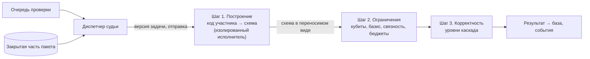

# 6. Тестирующая система: заглушка и контракт

[← к оглавлению](README.md)

## 6.1. Статус

Научная тестирующая система в разработке. Её основа — проверка эквивалентности генераторов схем для всех
размеров сразу ([`ladder_ec` v1.0.0](https://github.com/alpha7en/ladder_ec/tree/v1.0.0)) и каскад проверок из
материалов команды ([`docs/JUDGE.md`](../JUDGE.md), [`docs/specs/RESEARCH_ENTRYPOINT.md`](../specs/RESEARCH_ENTRYPOINT.md)).

В этом ТЗ судья — **заглушка**: сервис с окончательным внешним контрактом и простой внутренней реализацией на
численной симуляции. Задача разработчиков платформы — построить всё вокруг контракта так, чтобы замена
реализации не потребовала правок в API, базе и интерфейсе.

| Что фиксируется сейчас | Что остаётся заглушкой |
|---|---|
| Контракт «запрос → результат» (6.3) | Способ установить эквивалентность: сейчас численная симуляция на малых размерах |
| Формат пакета задачи и интерфейс `check.py` (6.4) | Доказательство эквивалентности для всех $n$ |
| Список вердиктов и подробностей (раздел 5.4) | Проверка больших схем (больше примерно 16 кубитов) |
| Изоляция исполнения чужого кода (6.5) | Шум, проверка на реальном железе |
| Непрозрачность оракулов (6.6) | Обнаружение списывания и автоматического синтеза |
| Порядок замены реализации (6.8) | — |

## 6.2. Место в системе



Судья — отдельный сервис. Он получает задания из очереди, читает закрытую часть пакета из объектного хранилища
и пишет результат. К данным пользователей у него доступа нет: в задании только идентификатор отправки, текст
решения и ссылка на версию задачи.

## 6.3. Контракт

**Запрос** (сообщение очереди):

```json
{
  "submission_id": "s_8kQ2xLm4",
  "attempt": 1,
  "task_version": {"code": "SA-005", "number": 3, "package_key": "packages/SA-005/3.tar", "package_sha256": "…"},
  "kind": "code",
  "source_key": "submissions/2026/11/s_8kQ2xLm4.py",
  "judge_profile": "numeric-v1",
  "seed": 918273645,
  "limits": {"build_time_ms": 10000, "memory_mb": 512, "total_time_ms": 60000}
}
```

**Результат:**

```json
{
  "submission_id": "s_8kQ2xLm4",
  "attempt": 1,
  "judge": {"profile": "numeric-v1", "version": "0.3.1", "qiskit": "2.6.2"},
  "verdict": "LE",
  "detail": {"metric": "depth", "value": 9, "limit": 6, "params": {"n": 8}},
  "score": null,
  "metrics": {"qubits": 8, "gates": 9, "depth": 9, "two_qubit": 8, "cx": 8, "t": 0, "oracle_calls": 0},
  "groups": [
    {"name": "ограничения", "status": "failed", "case": 4, "time_ms": 3},
    {"name": "корректность", "status": "skipped"}
  ],
  "guarantee": "numeric",
  "resources": {"cpu_ms": 412, "memory_kb": 181000},
  "log_key": "judge-logs/s_8kQ2xLm4/1.txt"
}
```

Поля, важные для будущей замены:

- `judge_profile` — какой набор уровней каскада применить; хранится в версии задачи. Новая реализация
  появляется как новый профиль, старые версии задач продолжают проверяться прежним.
- `guarantee` — сила утверждения: `numeric` (проверено на конечном наборе размеров и входов), `exact`
  (доказано для всех значений параметров), `probabilistic` (доказано с вероятностью ошибки не больше $2^{-k}$).
  Это прямое отражение ответов `ladder_ec`: «equal, exact», «equal, error $\le 2^{-k}$». Интерфейс пока не
  показывает это поле, но база его хранит.
- `detail.params` — на каких значениях параметров найдено расхождение. Для `ladder_ec` это контрпример
  $(n, a)$; его можно показать участнику как «расхождение при $n=3$».
- `groups` — результаты по группам тестов; содержимое тестов в результат не попадает.

## 6.4. Пакет задачи глазами судьи

Формат пакета описан в [`bank/README.md`](../../bank/README.md) и [`bank/CLASSIFICATION.md`](../../bank/CLASSIFICATION.md).
Судья использует:

| Часть пакета | Как используется |
|---|---|
| `task.yaml`: `facets`, `qubits`, `limits`, `budget`, `scoring`, `forbid` | шаг «ограничения»; выбор способа проверки по `facets.check` |
| `check.py`: `spec(**params)` | для шести отношений эквивалентности возвращает изометрию $W$ и числа $d_{\text{in}}$, $d_{\text{out}}$ |
| `check.py`: `GRID` | наборы параметров; в боевой версии дополняется закрытой сеткой |
| `check.py`: `verify(solve, task, kit)` | особые проверки: чёрный ящик, распределение, динамические схемы, программа с бюджетом |
| `check.py`: `WRONG` | неверные решения; используются при импорте версии (раздел 4.5), не при проверке участника |
| `reference.py` | эталон: при импорте — самопроверка; при проверке — ресурсы для сравнения и опорное решение для параметрического уровня |

Соглашения о кубитах — как в `ladder_ec` и в [`bank/tools/sakit.py`](../../bank/tools/sakit.py): кубит $i$ — бит
$i$ числа; рабочие кубиты первыми, анциллы последними; вход на кубитах $0,\dots,d_{\text{in}}-1$, остальные
начинают в $\lvert0\rangle$; выход на кубитах $0,\dots,d_{\text{out}}-1$, остальные обязаны вернуться в
$\lvert0\rangle$.

## 6.5. Исполнение кода участника

Самая опасная часть платформы: исполняется произвольный Python.

**Требования к изоляции**

1. Код участника выполняется только на шаге «построение» и только в исполнителе: отдельный контейнер с
   усиленной изоляцией (gVisor или микровиртуальная машина), без сети, с файловой системой только для чтения,
   с ограничениями на процессор, память, число процессов и время.
2. В исполнителе нет ничего секретного: ни закрытой части пакета, ни ключей, ни данных других участников.
3. Результат шага — схема в переносимом виде (QPY или OpenQASM 3) плюс журнал. Дальше работает только
   доверенный код судьи над этой схемой. Проверка корректности не исполняет код участника.
4. Исключение — ответ `hybrid`: программа участника вызывает функции платформы (`run`, `expval`). Эти вызовы
   идут из исполнителя к доверенной части судьи по каналу с одним разрешённым сообщением «выполнить схему»; сам
   расчёт и подсчёт бюджета — на доверенной стороне.
5. Список разрешённых импортов (`qiskit`, `numpy`, `math`, `cmath`) проверяется разбором кода до запуска и даёт
   вердикт `UM`. Это удобство и раннее сообщение об ошибке, а **не** защита: защита — изоляция из пункта 1.
6. Пределы на схему: не больше 30 кубитов и 200 000 инструкций в переносимом виде; превышение — вердикт `LE`
   без дальнейшей проверки.

**Скорость.** Импорт Qiskit занимает около 0,5 секунды. Исполнитель держит прогретый процесс с импортированным
Qiskit и для каждой отправки порождает от него изолированную копию; после отправки копия уничтожается.
Состояние между отправками не сохраняется.

**Версии.** Образ исполнителя фиксирует версии Python и Qiskit. Версия записывается в результат. Обновление
Qiskit — новый образ и прогон всего банка (эталон принят, неверные решения отклонены) до переключения.

## 6.6. Непрозрачные оракулы

В задачах с чёрным ящиком (`facets.input: oracle`) участник получает гейт `oracle`. В заглушке `sakit.as_gate`
это обычный гейт Qiskit: его определение и матрицу можно прочитать из кода и узнать секрет, не вызывая
оракул. Для демо-проверки банка это не важно, для платформы — недопустимо.

Требование: на шаге «построение» участнику передаётся **гейт-метка** — объект с именем `oracle` и числом
кубитов, без определения и без матрицы. Настоящий оператор подставляется доверенной стороной на шаге
«корректность», для каждого закрытого теста свой. Следствия:

- схема участника строится один раз на набор параметров, а проверяется на многих оракулах;
- число вызовов оракула считается по числу меток в схеме;
- для ответа `hybrid` запуск схем с метками выполняет доверенная сторона (пункт 4 в 6.5).

То же правило действует для закрытых параметров тестов: всё, что участник не должен знать, в исполнитель не
попадает.

## 6.7. Что реализовать сейчас: профиль `numeric-v1`

Первая реализация — перенос [`bank/tools/sakit.py`](../../bank/tools/sakit.py) и
[`bank/tools/verify.py`](../../bank/tools/verify.py) в сервис.

| Шаг | Что делает | Основа в репозитории |
|---|---|---|
| Построение | запускает `solve` в исполнителе для каждого набора параметров, получает схемы | новая часть |
| Ограничения | число кубитов, базис, связность, `limits`, `forbid` | `sakit.check_limits`, `sakit.metrics` |
| Корректность: отношения эквивалентности | сравнение с изометрией $W$ с точностью до фазы или точно | `sakit.check_isometry` |
| Корректность: особые проверки | распределения, вероятности, ветви измерений, программы | `verify` в `check.py`, `sakit.run_dynamic`, `sakit.distribution` |
| Оценка | баллы по формуле `scoring` | функция `score` в `check.py` |
| Результат | вердикт и подробность по таблице раздела 5.4 | новая часть |

Отличия от `verify.py`, которые нужно сделать:

1. Раздельное исполнение: `solve` — в исполнителе, `spec` и `verify` — на доверенной стороне (6.5). Сейчас
   `verify` вызывает `solve` напрямую — интерфейс `verify(solve, task, kit)` сохраняется, но `solve` становится
   посредником, который обращается к исполнителю.
2. Непрозрачные оракулы (6.6).
3. Закрытая сетка параметров и зерно из запроса.
4. Вердикты и подробности вместо пары «прошло или нет и строка».
5. Ограничение времени на каждый шаг и на проверку целиком.
6. Порядок сообщения из раздела 5.4: неверный ответ важнее лимита.

**Приёмка заглушки.** Через боевой конвейер (очередь, исполнитель, запись результата) прогоняются все задачи
ядра: 61 эталон получает `AC` (для SA-044 — `PS` со 100 баллами), 74 неверных решения из `WRONG` получают
ожидаемые вердикты. Список «неверное решение → ожидаемый вердикт» добавляется в пакеты как поле словаря `WRONG`
при переносе. Дополнительно переносятся отрицательные случаи браузерного судьи из
[`tests/judge.test.mjs`](../../tests/judge.test.mjs): лишний $Z$, $CX$ вместо $CZ$, мусор в анцилле.

**Известные пределы заглушки** — их нужно честно показать в интерфейсе автора задач:

- проверка идёт на конечной сетке размеров; решение, верное при $n\le 8$ и неверное при $n=9$, пройдёт, если
  $9$ нет в сетке;
- вектор состояния — до примерно 16–20 кубитов, оператор — до 10–12;
- динамические схемы проверяются перебором ветвей: число ветвей растёт как $2^m$ от числа измерений;
- статистические проверки (программа с бюджетом запусков) зависят от зерна;
- шум и нативные временны́е характеристики не моделируются.

## 6.8. Как подключать настоящую систему

Каскад из материалов команды: быстрые проверки → точная проверка для классов, где она эффективна → проверка с
учётом вспомогательных кубитов → выборочное тестирование. В терминах профилей:

| Уровень | Что даёт | Когда применим | Готовность |
|---|---|---|---|
| 0. Построение и ограничения | отсев по базису, связности, бюджетам | всегда | в `numeric-v1` |
| 1. Численная симуляция | проверка на сетке размеров | малые размеры | в `numeric-v1` |
| 2. Параметрическая эквивалентность (`ladder_ec`) | ответ для всех $n$: «равны точно», «равны с ошибкой не больше $2^{-k}$», «не равны, контрпример $(n,a)$» | генераторы из поддерживаемого фрагмента, шесть отношений | библиотека есть, требуется расширение фрагмента |
| 3. Символьные методы для фиксированных схем | большие $n$ без симуляции | классы схем, где метод эффективен | исследование |
| 4. Выборочное тестирование с оценкой надёжности | всё остальное | — | исследование |

### Что показала проверка банка библиотекой `ladder_ec`

Эталоны 24 задач ядра с ответом «генератор» и одним из шести отношений были поданы в `ladder_ec` v1.0.0
(сравнение эталона с самим собой, Python 3.13, Qiskit 2.6.2).

| Итог | Задач | Какие |
|---|--:|---|
| Ответ получен: «equal, exact» | 2 | SA-003, SA-020 |
| Отказ транслятора | 22 | см. ниже |

| Код отказа | Задачи | Причина |
|---|---|---|
| `growing_arity` | SA-017, 025, 027, 033 | многоконтрольный гейт на списке, растущем с $n$ |
| `no_size_dependence` | SA-015, 045, 058 | параметр — данные или угол, размера нет |
| `unsupported_expression` | SA-009, 010, 021 | вычисления над параметрами-данными |
| `nonaffine_expression` | SA-005, 018 | индексы вида $\lfloor n/2\rfloor$ |
| `branch_on_size` | SA-022, 026 | ветвление по $n$ |
| `two_registers` | SA-024, 028 | индексы вида $n+i$ |
| `while_loop` | SA-004 | удвоение в цикле `while` |
| `nonconst_angle` | SA-006 | угол зависит от $n$ и счётчика |
| `range_not_ladder` | SA-008 | цикл с шагом 2 |
| `nested_loop` | SA-016 | двойной цикл преобразования Фурье |
| `bit_param_misuse`, `unsupported_statement` | SA-059, 060 | вещественные параметры, обход списка рёбер |

На принятых задачах библиотека ведёт себя так, как нужно платформе: для SA-003 решение «звездой» признано
равным эталону-цепочке по отношению `eq0_phase`, решение «$H$ на всех кубитах» отклонено с контрпримером
$n=2$, а при отношении `eq_phase` та же «звезда» отклонена с контрпримером $n=3$ — операторы действительно
разные.

Выводы для платформы:

1. Параметрический уровень сейчас покрывает малую долю банка, поэтому численный уровень — не временная
   подпорка, а постоянная часть каскада. Отказ транслятора не является вердиктом: отправка переходит на
   следующий уровень.
2. Отказ бывает и у эталона, и у решения участника. Правило: если отказ у эталона — уровень для задачи
   отключён; если только у решения — проверка идёт численно, а в результат пишется `guarantee: numeric`.
3. Для задач, где нужна гарантия «для всех $n$», автор пишет эталон в стиле, который транслятор принимает
   (список — в README `ladder_ec`, раздел Supported fragment, и в `docs/refusal_codes.md`). Признак «эталон
   принят параметрическим уровнем» вычисляется при импорте версии и показывается автору.
4. Карточки банка уже хранят отношение в терминах `ladder_ec` (`facets.check`), так что подключение уровня не
   требует изменений в данных.

### Порядок подключения нового уровня

1. Новый уровень оформляется как профиль (`ladder-v1`), включающий прежние уровни.
2. **Теневой режим:** новый профиль проверяет те же отправки параллельно, результат пишется в журнал, но не
   влияет на вердикт. Расхождения с действующим профилем разбираются вручную.
3. **Прогон банка:** все эталоны и неверные решения, а также накопленные отправки участников.
4. **Переключение по задачам:** профиль назначается версиям задач, а не всей платформе.
5. **Перепроверка** по решению жюри; изменение вердиктов — по правилам раздела 5.3.

## 6.9. Проверка примеров в браузере

Кнопка «Проверить примеры» работает без сервера: браузерный судья демо ([`assets/js/judge/`](../../assets/js/judge))
проверяет решение на открытых примерах из условия. Требования:

- используются только открытые примеры и открытые ограничения;
- результат подписан как предварительный: «примеры пройдены» не означает «принято»;
- расхождение между браузерной и серверной проверкой на одном и том же примере — дефект; общий набор схем для
  сверки двух реализаций описан в разделе 7.6.

## 6.10. Что не входит в заглушку, но должно иметь место в данных

| Тема | Где заложено место |
|---|---|
| Заимствованные анциллы | `facets.ancilla.kind: dirty`; пример — SA-029 |
| Шум как часть условия | вердикт `NZ`, проверка `fidelity`; идеи SR-120–122 |
| Оценка по стоимости | `scoring`, вердикт `PS`; пример — SA-044 |
| Обнаружение списывания | хранение всех отправок и схем в переносимом виде; сравнение — отдельная задача (раздел 8.6) |
| Запуск на реальном устройстве | профиль судьи с другим исполнителем; контракт не меняется |
