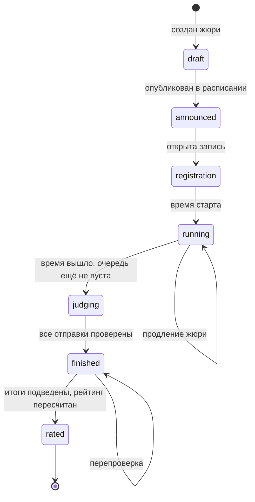

# 8. Раунды, таблица результатов, рейтинг

[← к оглавлению](README.md)

Правила взяты из демо ([`docs/DEMO_DATA.md`](../DEMO_DATA.md), [`assets/js/data/roundstate.js`](../../assets/js/data/roundstate.js),
[`rounds.js`](../../assets/js/data/rounds.js)). **[Д]** Формат и формулы — допущение: если на созвонах принято
другое, меняются параметры, а не устройство.

## 8.1. Виды соревнований

| Вид | Рейтинг | Описание |
|---|:-:|---|
| Рейтинговый раунд | да | общее время старта, 90 минут, 4 задачи; по воскресеньям в 12:00 мск |
| Нерейтинговый раунд | нет | тот же формат; тематические, пробные, партнёрские |
| Участие «с таймером» | нет | прошедший раунд в личном времени: свой старт, свои 90 минут, место «вне конкурса» в исходной таблице |
| Дорешивание | нет | после конца раунда задачи открыты в банке; отправки идут как обычные |
| Тренировка | нет | набор задач без ограничения времени, с таблицей группы |
| Экзамен | нет | закрытая группа, отдельные правила; отдельный этап, в модели данных — `kind = exam` |

Нумерация раундов платформы начинается с 1. Номера демо (от 522) были частью смоделированной истории.

## 8.2. Состояния раунда

Переходы по времени выполняет сервер; интерфейс лишь показывает состояние. Часы участника не используются
нигде: обратный отсчёт строится от серверного времени, полученного при загрузке страницы, и поправляется при
каждом ответе API.

## 8.3. Правила раунда

| Правило | Значение | Параметр в `contests.rules` |
|---|---|---|
| Длительность | 90 минут | `duration_s` |
| Задач | 4 | — |
| Баллы за задачи | 100, 200, 200, 300 | `points` в `contest_tasks` |
| Задачи с оценкой | баллы задачи умножаются на долю из формулы `scoring` | `scoring_mode` |
| Сравнение участников | больше баллов; при равенстве — меньше штрафное время | — |
| Штрафное время | по каждой решённой задаче: минуты от старта до принятого решения плюс 5 минут за каждую неверную отправку до него | `wrong_penalty_min` |
| Что считается неверной отправкой | вердикты со штрафом из таблицы раздела 5.4; `CE`, `UM`, `IE` штрафа не дают | — |
| Отправки после принятого решения | принимаются и проверяются, на результат не влияют | — |
| Шум | деполяризующий, $\varepsilon=1\,\%$ на двухкубитные гейты — когда судья это поддерживает; в заглушке выключен | `noise` |
| Регистрация | до старта и в течение раунда; опоздавший теряет прошедшее время | `late_registration` |
| Заморозка таблицы | не используется; место под неё есть | `freeze_s` |
| Открытие чужих решений | после конца раунда | `open_submissions_after` |

Задача раунда — закреплённая версия задачи банка, скрытая до старта (`tasks.visible_from`). После раунда она
появляется в банке под своим постоянным номером `SA-NNN`.

## 8.4. Проведение

**До раунда**

- Жюри собирает раунд из версий задач; платформа проверяет, что каждая версия прошла боевого судью
  (раздел 4.5) и что задачи не опубликованы.
- Пробный запуск: закрытый раунд-копия для жюри, на котором прогоняются эталоны и неверные решения всех задач
  через полный конвейер. Без успешного пробного запуска раунд нельзя объявить.
- Напоминания записавшимся: за сутки и за 15 минут — почтой и в колокольчике.
- За час до старта условия задач раунда готовятся и помещаются в кэш; число исполнителей судьи увеличивается
  по расписанию.

**Во время**

- Страница раунда и страницы задач отдаются из кэша; старт не создаёт пиковой нагрузки на базу (раздел 3.3).
- Вопросы жюри: участник задаёт вопрос по задаче; жюри отвечает лично или объявляет всем. Объявление
  приходит всем участникам потоком событий и остаётся на странице раунда.
- Жюри видит: длину очереди, время ожидания, долю каждого вердикта по задачам, список внутренних ошибок.
- Жюри может: продлить раунд, сделать его нерейтинговым, снять задачу, перепроверить задачу, дисквалифицировать
  участника. Каждое действие записывается в журнал.

**После**

- Раунд переходит в `finished`, когда очередь его отправок пуста.
- Итоги подводятся автоматически через заданное время (по умолчанию 30 минут — на апелляции и проверку
  жюри) или вручную.
- Публикуются разборы; задачи открываются в банке; участники получают изменение рейтинга.

## 8.5. Таблица результатов

Требования:

1. Таблица идущего раунда живёт в Redis: упорядоченное множество участников с составным ключом сортировки
   (баллы по убыванию, штрафное время по возрастанию) и хэш с ячейками по задачам.
2. Обновление — при каждом вердикте по отправке раунда, одной атомарной операцией.
3. Источник правды — отправки в PostgreSQL. Таблица в любой момент может быть пересчитана заново и обязана
   совпасть; пересчёт запускается автоматически после сбоя Redis и после перепроверки.
4. Чтение: страница таблицы (50 строк), строка участника с его местом, поиск по логину, фильтр по вузу.
5. Рассылка изменений — пачками раз в 1–2 секунды (раздел 5.6). При 5 000 участников и 55 вердиктах в секунду
   клиент получает только изменения своей страницы.
6. Ячейка задачи: «+» или «+2» (число неверных попыток до принятия) и время; «−3» — три неверные попытки без
   принятия; пусто — не было отправок. Для задач с оценкой — баллы.
7. После подведения итогов таблица сохраняется в `contest_entries` и отдаётся из базы и кэша.
8. Участие «с таймером»: строки таких участников показываются отдельной меткой и не сдвигают места
   участников исходного раунда.

## 8.6. Рейтинг

**Что переносится из демо.** После рейтингового раунда рейтинг участника меняется на

$$\Delta=K\,(p-E),\qquad p=1-\frac{m-1}{N-1},\qquad E=\frac{1}{1+10^{(1330-R)/400}},$$

где $m$ — место, $N$ — число участников раунда, $R$ — рейтинг до раунда; $K=90$ для первых трёх раундов
участника, $56$ до восьмого, далее $36$. Начальное значение — $1200$. Титулы: новичок — ниже 1200, ученик — от
1200, специалист — от 1400, эксперт — от 1700, мастер — от 2000, гроссмейстер — от 2400.

**Что нужно решить до запуска.** **[Д]** Формула демо сравнивает участника с постоянным «средним» рейтингом
1330, а не с реальным составом раунда. На смоделированных участниках это работало; на настоящих приведёт к
дрейфу: сумма рейтингов не сохраняется, слабый состав раунда раздаёт рейтинг так же, как сильный. Рекомендуется
заменить ожидаемую долю на расчёт по составу раунда:

$$E_i=\frac{1}{N-1}\sum_{j\ne i}\frac{1}{1+10^{(R_j-R_i)/400}},$$

то есть среднюю вероятность того, что участник $i$ выше участника $j$. Остальное — $p$, $K$, титулы — остаётся.

Требования к подсистеме рейтинга независимо от формулы:

1. Формула — отдельный модуль с версией; версия записывается в `rating_changes`.
2. Пересчёт раунда идемпотентен: повторный запуск даёт тот же результат.
3. Откат: изменение рейтинга раунда можно отменить и применить заново (после перепроверки или
   дисквалификации); последующие раунды пересчитываются цепочкой.
4. Перед запуском формула прогоняется на истории отправок закрытой беты; смотрится распределение рейтингов и
   отсутствие дрейфа среднего.
5. Рейтинг вуза — сумма рейтингов десяти лучших участников вуза (правило демо), считается при запросе и
   кэшируется. Привязка к вузу — по заявлению участника; подтверждение (почта в домене вуза) — признак
   `verified` **[Д]**.

## 8.7. Честность соревнования

| Угроза | Мера в первой версии | Позже |
|---|---|---|
| Доступ к тестам и эталонам | закрытая часть пакета не покидает судью; автоматический тест на утечки в API (раздел 5.2) | — |
| Чтение оракула вместо вызова | непрозрачные оракулы (раздел 6.6) | — |
| Перебор схем | лимиты задач подбирает автор; ограничение частоты отправок (раздел 5.5) | оценка пространства перебора при импорте задачи |
| Автоматический синтез вместо решения | параметрические задачи и жёсткие бюджеты — на уровне банка (см. [`docs/specs/04_qcoder_mechanics_oracles_and_antibruteforce.md`](../specs/04_qcoder_mechanics_oracles_and_antibruteforce.md)) | признаки автоматического синтеза в схеме |
| Списывание | все отправки и схемы хранятся в переносимом виде; жюри может сравнить отправки вручную | автоматическое сравнение схем с точностью до перестановок и переименований |
| Несколько аккаунтов | подтверждение почты; пределы регистрации; журнал адресов входа, доступный жюри | — |
| Решение раунда вдвоём | правила участия; дисквалификация по решению жюри | — |
| Перегрузка очереди отправками | ограничение частоты; отдельная очередь раунда | — |

Дисквалификация убирает участника из таблицы и отменяет его изменение рейтинга; места остальных
пересчитываются. Решение принимает жюри, действие записывается в журнал, участник получает уведомление с
причиной.
